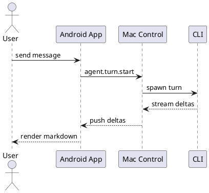
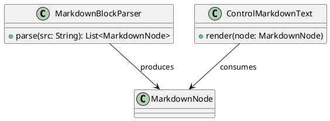
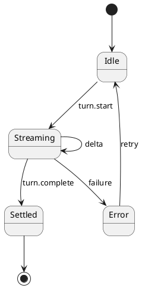
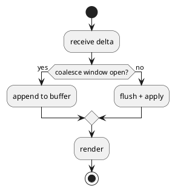

# 🧪 Markdown Renderer Torture Fixture

A reusable, diagram-heavy fixture for exercising `core/markdown-renderer`.
Kitchen-sink by design: it deliberately includes constructs the renderer may
**not** support yet (PlantUML, nested diagrams-in-quotes) so unsupported paths
are part of the test surface, not an oversight.

---

## 1. Inline text styles

**bold**, *italic*, ***bold italic***, `inline code`, ~~strikethrough~~, and a
mix: **bold with `code` inside** plus *italic with [a link](https://example.com) inside*.

Intraword underscores_should_not_italicize. But _a fenced phrase_ should.
Escaped: \*not italic\*, \`not code\`, \# not a heading.

---

## 2. Diagrams — PlantUML

### 2a. Sequence diagram



### 2b. Class diagram



### 2c. State diagram



### 2d. Activity diagram



### 2e. PlantUML inside a blockquote (nesting stress)

> Design note — the connection state machine:
>
> ```plantuml
> @startuml
> [*] --> Disconnected
> Disconnected --> Connecting : attemptRestore
> Connecting --> Connected : ok
> Connecting --> Disconnected : fail
> Connected --> Disconnected : drop
> @enduml
> ```

### 2f. PlantUML inside a list item

1. First, the happy path.
2. Then the component view:
   ```plantuml
   @startuml
   component "markdown-renderer" as MR
   component "streaming" as S
   S --> MR : healed markdown
   @enduml
   ```
3. Done.

---

## 3. Blockquotes (nested deep)

> Level 1.
> > Level 2.
> > > Level 3 with **bold**, `code`, and a nested list:
> > > - item
> > >   - sub-item
> > >     1. ordered-in-unordered-in-quote

---

## 4. Lists — every flavor

### Unordered, deeply nested

- Fruit
  - Citrus
    - Orange
    - Lemon
      - Meyer lemon *(a hybrid)*
- Vegetables
  - Leafy
    - Kale

### Ordered with re-nesting

1. First
2. Second
   - note
     1. Sub-step **A**
        - deeper bullet with `code`

### Task list (nested)

- [x] Write the fixture
- [x] Include ~~easy~~ **all** the diagram types
- [ ] Nested:
  - [x] done subtask
  - [ ] pending subtask
    - [ ] deeply nested pending

---

## 5. Code — inline and blocks

Inline: `git rebase -i HEAD~3`.

```kotlin
fun renderMarkdown(sample: String) {
    val file = "controlAndroid/core/markdown-renderer/.../ControlMarkdownText.kt:22"
    println(sample)
}
```

```bash
#!/usr/bin/env bash
set -euo pipefail
for f in *.md; do echo "Processing $f"; done
```

Literal markdown that must NOT render (inside a fence):

```markdown
# stays literal
- [ ] stays literal
> stays literal
```

Quadruple fence holding a triple fence:

````
Here is a ``` triple backtick ``` shown literally.
````

---

## 6. Tables

| Surface | Expected | File |
| :--- | :---: | ---: |
| Inline path | Tinted, tappable | controlAndroid/feature/conversation/MarkdownText.kt:34 |
| Directory | Folder icon | /Users/aliumujib/Desktop |
| `code` cell | Monospace | `src/Ignored.kt` |
| Right aligned | Hugs right | 42 |

Ragged / escaped / unicode:

| Col A | Col B | Col C |
|-------|-------|-------|
| full | | full again |
| pipe: `a \| b` | 中文字符 | émojis 🥑🔥 |
| short | | |

---

## 7. Links and images

- Inline: [Anthropic](https://anthropic.com)
- Autolink: <https://www.example.com>
- Reference: [see the docs][docs]


[docs]: https://example.com/docs "Reference link definition"

---

## 8. Horizontal rules

---

***

___

---

## 9. Unicode, RTL, emoji

- Arabic (RTL): مرحبا بالعالم
- CJK: 日本語のテキスト、中文文本、한국어 텍스트
- Math symbols: ∑ ∫ √ ∞ ≠ ≈ ≤ ≥
- ZWJ emoji: 👨‍👩‍👧‍👦 🏳️‍🌈 👩‍💻
- Skin tones: 👋🏻 👋🏽 👋🏿

---

## 10. Final boss — quote + task list + table + PlantUML

> **Sprint review**
> > **Blocked items:**
> > - [ ] API migration
> >   - [x] Schema drafted
> >   - [ ] Endpoints — *waiting on `auth`*
> >     | Endpoint | Status |
> >     |----------|--------|
> >     | `/users` | done |
> >     | `/orders` | WIP |
> > - [x] ~~Old thing~~ (removed)
> >
> > ```plantuml
> > @startuml
> > [*] --> Blocked
> > Blocked --> Done : unblock
> > @enduml
> > ```

---

*End of fixture — if this renders cleanly (and degrades gracefully on the
PlantUML blocks), the renderer survived.* 🎊
